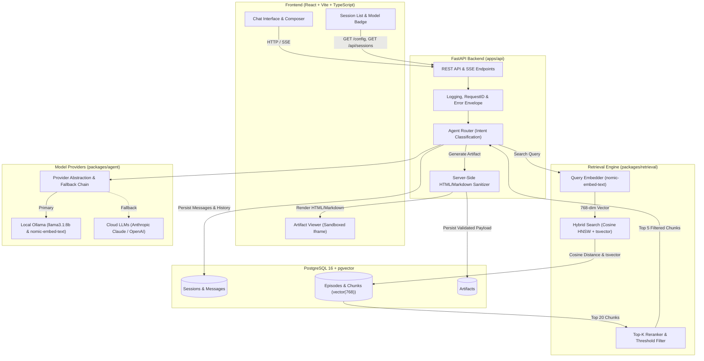
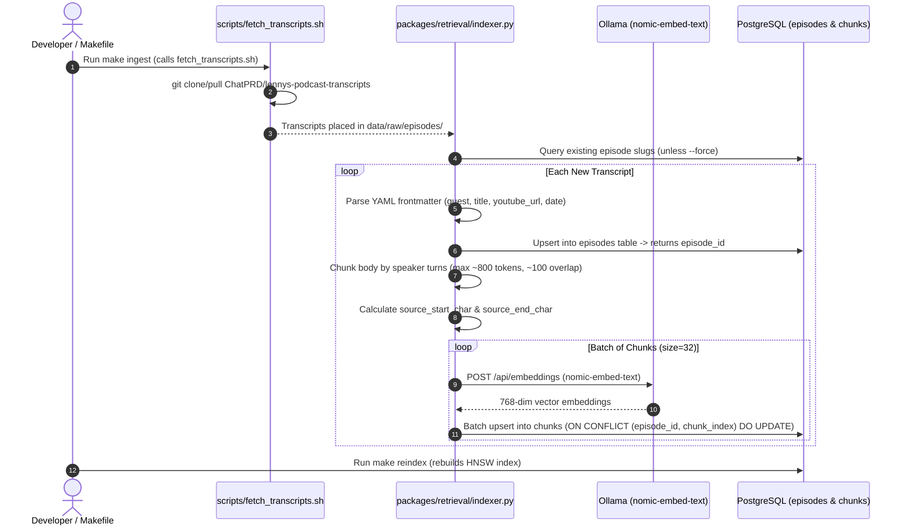
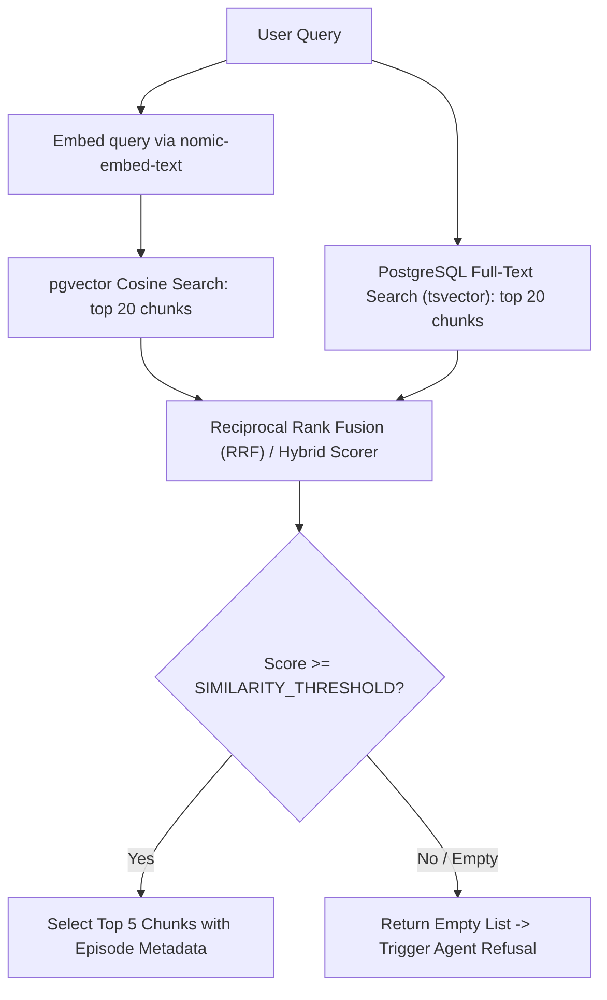
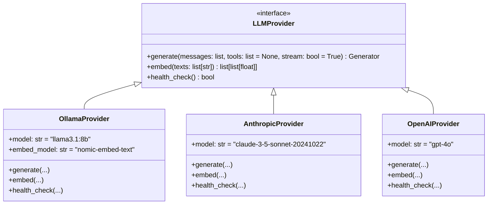
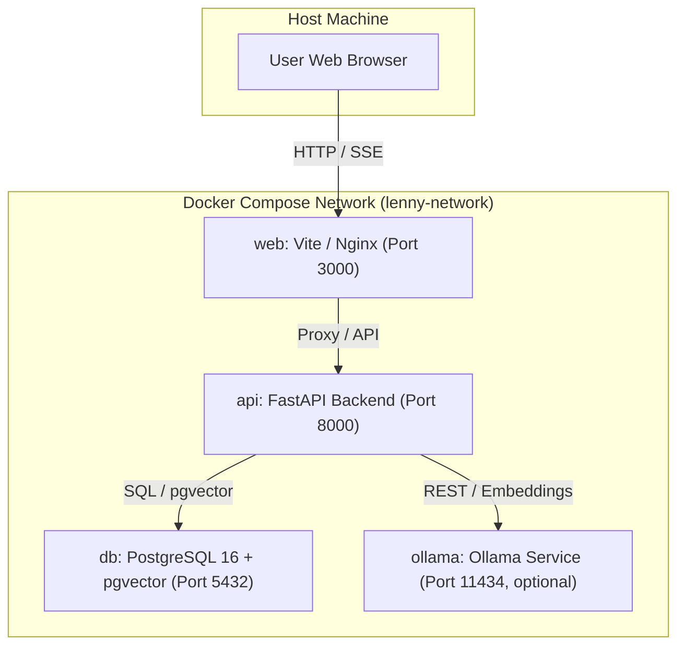

# System Architecture — Lenny Growth Assistant

## 1. System Overview

The Lenny Growth Assistant is a local-first, full-stack AI conversational web application designed to turn Lenny's Podcast transcripts into authoritative, grounded answers, structured Ship 30 for 30 essays, and rendered visual artifacts. The user interacts through a modern React + Vite + TypeScript frontend that communicates with a FastAPI backend. The backend orchestrates conversation sessions, executes an agent routing loop, interfaces with a hybrid vector/keyword retrieval engine backed by PostgreSQL with `pgvector`, and interfaces with local Ollama (`llama3.1:8b`) or cloud LLM providers (Anthropic Claude / OpenAI) with automatic failover. Generated artifacts (Markdown and sanitized HTML/CSS) are rendered in a side-by-side sandboxed viewer isolated from host application security contexts.



---

## 2. Repository Structure

The repository follows a clean, modular monorepo structure separating frontend applications, backend services, domain-specific Python packages, data storage, and operational scripts.

```text
lenny-growth-assistant/
├── apps/
│   ├── api/                     # FastAPI backend application
│   │   ├── main.py              # Application entrypoint & middleware configuration
│   │   ├── config.py            # Pydantic v2 application settings
│   │   ├── dependencies.py      # Dependency injection (DB session, provider client)
│   │   └── routers/             # API routers (health, config, sessions, artifacts)
│   └── web/                     # React + Vite + TypeScript frontend
│       ├── src/
│       │   ├── components/      # UI components (Chat, Composer, Sidebar, Viewer)
│       │   ├── hooks/           # Custom React hooks (useChat, useSessions, useSSE)
│       │   ├── services/        # API client and streaming handlers
│       │   └── types/           # Frontend TypeScript interfaces
│       ├── index.html           # HTML entrypoint
│       └── package.json         # Frontend dependencies and scripts
├── packages/
│   ├── retrieval/               # Retrieval, chunking, and embedding engine
│   │   ├── chunker.py           # Speaker-turn text splitting with token overlap
│   │   ├── embedder.py          # Embedding generation via Ollama nomic-embed-text
│   │   ├── indexer.py           # Ingestion orchestrator & HNSW indexing
│   │   └── search.py            # Hybrid search (pgvector cosine + full-text search)
│   ├── agent/                   # Agent intelligence, skills, and model routing
│   │   ├── router.py            # Intent classifier (qa, ship30, artifact, refusal)
│   │   ├── context.py           # Sliding-window session context assembly
│   │   ├── skills/              # Specialized capabilities (ship30, grounded_qa, artifact)
│   │   └── providers/           # LLM provider implementations (Ollama, Claude, OpenAI)
│   └── shared/                  # Common domain models, schemas, and utilities
│       ├── models.py            # Pydantic v2 API request/response contracts
│       ├── db_models.py         # SQLAlchemy 2.x ORM models
│       ├── errors.py            # Structured error definitions and codes
│       └── logging.py           # Structured JSON logger setup
├── data/
│   ├── raw/                     # [gitignored] Raw transcript files from Git submodule/clone
│   │   └── episodes/            # Cloned Lenny's podcast transcript repository
│   └── processed/               # [gitignored] Intermediate tokenized chunks and caches
├── tests/
│   ├── unit/                    # Fast isolated tests for models, chunker, and sanitizers
│   ├── integration/             # Database, API endpoint, and provider failover tests
│   └── eval/                    # 25-question golden evaluation suite and benchmark harness
├── docs/                        # Architectural, product, and design documentation
│   ├── PRD.md                   # Product Requirements Document
│   ├── architecture.md          # System architecture, schemas, and flows
│   ├── design.md                # UI/UX design specifications and interaction states
│   ├── security.md              # Artifact viewer threat model and sandbox specifications
│   ├── decisions.md             # Architecture decision records (ADRs)
│   └── assessment-brief.md      # Original engagement brief and constraints
├── scripts/
│   ├── fetch_transcripts.sh     # Transcript downloader script
│   └── dev_helpers.py           # Database seeding and migration helper utilities
├── alembic/                     # Database migration scripts (SQLAlchemy 2.x)
│   ├── env.py                   # Migration environment configuration
│   └── versions/                # Versioned migration revision files
├── docker-compose.yml           # Container topology (PostgreSQL+pgvector, API, Web, Ollama)
├── Makefile                     # Standard developer commands (dev, test, ingest, eval)
├── .env.example                 # Safe environment variable configuration template
├── README.md                    # Project documentation, onboarding, and quickstart
└── AGENTS.md                    # Coding agent rules, standards, and scope boundaries
```

### Folder Roles & Boundaries
- **`apps/api/`**: Stateless web layer exposing JSON/SSE endpoints; contains route handlers, dependency injection, and HTTP middleware.
- **`apps/web/`**: Client presentation layer; handles streaming rendering, markdown display, session management, and sandbox iframe sandboxing.
- **`packages/retrieval/`**: Self-contained RAG module responsible for document chunking, embeddings, hybrid search, and ranking.
- **`packages/agent/`**: Core intelligence layer; handles intent classification, prompt construction, skill execution, and LLM abstraction.
- **`packages/shared/`**: Single source of truth for Pydantic contracts, SQLAlchemy entities, structured logging, and error models.
- **`data/`**: Data workspace for raw transcript downloads and intermediate processing. Excluded from version control.
- **`tests/`**: Unified testing suite covering pytest backend tests, Vitest frontend tests, and the golden evaluation benchmark.
- **`scripts/`**: Automation scripts for transcript cloning and developer convenience.
- **`alembic/`**: Version-controlled database schema evolution using SQLAlchemy metadata.

---

## 3. Database Schema

All persistent state is stored in PostgreSQL 16 equipped with the `pgvector` extension.

```sql
-- Enable pgvector and UUID extensions
CREATE EXTENSION IF NOT EXISTS "uuid-ossp";
CREATE EXTENSION IF NOT EXISTS "vector";

-- Enum types
CREATE TYPE role_enum AS ENUM ('user', 'assistant', 'system');
CREATE TYPE artifact_type_enum AS ENUM ('markdown', 'html');

-- 1. Sessions table
CREATE TABLE sessions (
    id UUID PRIMARY KEY DEFAULT gen_random_uuid(),
    created_at TIMESTAMPTZ NOT NULL DEFAULT NOW(),
    updated_at TIMESTAMPTZ NOT NULL DEFAULT NOW(),
    user_metadata JSONB DEFAULT '{}'::jsonb
);

-- 2. Messages table
CREATE TABLE messages (
    id UUID PRIMARY KEY DEFAULT gen_random_uuid(),
    session_id UUID NOT NULL REFERENCES sessions(id) ON DELETE CASCADE,
    role role_enum NOT NULL,
    content TEXT NOT NULL,
    citations JSONB DEFAULT '[]'::jsonb,
    model TEXT NOT NULL,
    created_at TIMESTAMPTZ NOT NULL DEFAULT NOW()
);
CREATE INDEX idx_messages_session_id_created_at ON messages(session_id, created_at ASC);

-- 3. Episodes table
CREATE TABLE episodes (
    id UUID PRIMARY KEY DEFAULT gen_random_uuid(),
    slug VARCHAR(255) UNIQUE NOT NULL,
    guest VARCHAR(255) NOT NULL,
    title VARCHAR(512) NOT NULL,
    youtube_url VARCHAR(1024),
    video_id VARCHAR(64),
    publish_date DATE,
    description TEXT,
    duration_seconds INTEGER,
    channel VARCHAR(128) DEFAULT 'Lenny''s Podcast'
);

-- 4. Chunks table
CREATE TABLE chunks (
    id UUID PRIMARY KEY DEFAULT gen_random_uuid(),
    episode_id UUID NOT NULL REFERENCES episodes(id) ON DELETE CASCADE,
    chunk_index INTEGER NOT NULL,
    text TEXT NOT NULL,
    token_count INTEGER NOT NULL,
    embedding VECTOR(768) NOT NULL,
    source_start_char INTEGER NOT NULL,
    source_end_char INTEGER NOT NULL,
    created_at TIMESTAMPTZ NOT NULL DEFAULT NOW(),
    CONSTRAINT uq_episode_chunk UNIQUE (episode_id, chunk_index)
);

-- 5. Artifacts table
CREATE TABLE artifacts (
    id UUID PRIMARY KEY DEFAULT gen_random_uuid(),
    message_id UUID NOT NULL REFERENCES messages(id) ON DELETE CASCADE,
    type artifact_type_enum NOT NULL,
    title VARCHAR(255) NOT NULL,
    content TEXT NOT NULL,
    created_at TIMESTAMPTZ NOT NULL DEFAULT NOW()
);
CREATE INDEX idx_artifacts_message_id ON artifacts(message_id);

-- Full-text search tsvector column on chunks
ALTER TABLE chunks ADD COLUMN text_tsv TSVECTOR
    GENERATED ALWAYS AS (to_tsvector('english', text)) STORED;
CREATE INDEX idx_chunks_text_tsv ON chunks USING GIN(text_tsv);

-- HNSW Cosine Index for pgvector
CREATE INDEX idx_chunks_embedding_hnsw 
ON chunks USING hnsw (embedding vector_cosine_ops)
WITH (m = 16, ef_construction = 64);
```

### Embedding Dimensionality & Indexing Details
- **Embedding Dimension:** `VECTOR(768)` matches the native output dimension of Ollama's `nomic-embed-text` embedding model.
- **HNSW Index:** Built using `vector_cosine_ops` to enable rapid cosine similarity search without loading the full vector table into memory during query execution.
- **Idempotency Constraint:** `UNIQUE (episode_id, chunk_index)` prevents duplicate chunk inserts during re-ingestion.
- **Schema Migrations:** Migrations are autogenerated from SQLAlchemy metadata via `alembic revision --autogenerate`, then reviewed and committed to `alembic/versions/`.

---

## 4. Ingestion Pipeline

The ingestion pipeline transforms raw markdown transcripts into structured database records with vector embeddings.



### Pipeline Steps
1. **Fetch:** `scripts/fetch_transcripts.sh` clones or updates the `ChatPRD/lennys-podcast-transcripts` repository into `data/raw/episodes/`.
2. **Metadata Parsing:** The parser reads each `{guest}/transcript.md`, parses YAML frontmatter (guest, title, youtube_url, video_id, publish_date, description), and inserts or updates the record in the `episodes` table.
3. **Turn-Aware Chunking:** The transcript body is split along natural speaker boundaries. If a speaker turn exceeds ~800 tokens, it is split into overlapping windows (~100 token overlap). Every chunk retains `source_start_char` and `source_end_char` offsets relative to the raw file for complete auditability.
4. **Vector Embedding:** The embedder batches chunk text and requests 768-dimensional embeddings from Ollama's `nomic-embed-text` service.
5. **Idempotent Upsert & Manifest Cache:** Chunks are written to the `chunks` table with `ON CONFLICT (episode_id, chunk_index) DO UPDATE`. `data/processed/` stores cached embedding batches and per-episode ingestion manifests (JSON) used to skip already-processed episodes idempotently.
6. **Execution Commands:**
   - `make ingest`: Executes the ingestion pipeline, skipping already-indexed episodes unless `--force` is supplied.
   - `make reindex`: Drops and rebuilds the `idx_chunks_embedding_hnsw` index to optimize search performance after batch ingestion.

---

## 5. Retrieval

The retrieval engine employs a hybrid search strategy combining dense semantic vector search with sparse lexical matching.



### Retrieval Logic
1. **Query Embedding:** Incoming user queries are embedded via Ollama `nomic-embed-text` producing a 768-dimensional float vector.
2. **Vector Candidate Selection:** Cosine distance query against `chunks.embedding` (`ORDER BY embedding <=> query_vector ASC LIMIT 20`).
3. **Hybrid Keyword Matching (Optional):** Chunks matching query keywords via PostgreSQL `text_tsv @@ websearch_to_tsquery('english', query)` are scored.
4. **Scoring & Reranking:** Hybrid results are merged with Reciprocal Rank Fusion (RRF) using k=60 to produce a combined relevance score and trimmed to the top 5 chunks.
5. **Enrichment:** Selected chunks are hydrated with episode metadata: `episode_title`, `guest`, `youtube_url`, `chunk_text`, and `similarity_score`.
6. **Relevance Threshold & Refusal Gate:** pgvector returns cosine distance via the `<=>` operator (lower is more similar). We filter chunks where distance > MAX_COSINE_DISTANCE (default 0.35, equivalent to similarity < 0.65). The threshold is configurable via env var. If no chunks remain, retrieval returns empty and the agent must refuse.

### 5.7 Embedding Failure Handling
Query embedding depends on Ollama nomic-embed-text. If Ollama is unreachable at query time:
- Attempt hybrid keyword-only retrieval using `text_tsv @@ websearch_to_tsquery('english', query)`.
- If keyword search returns zero chunks above threshold, return an empty result set and trigger agent refusal.
- Never silently fabricate. Never fall back to LLM-only answering without retrieval.
- Note: pre-ingested chunk embeddings remain valid; only the query-time embedding fails.

---

## 6. Agent Architecture

The agent orchestrates the conversational interaction, enforces grounding constraints, and executes dedicated skills.

### Intent Classifier & Router
The router evaluates the user's message and current session context to classify intent into four paths:
- **`qa`**: Standard conversational question requiring grounded transcript retrieval and citations.
- **`ship30`**: User request for a Ship 30 for 30 style essay.
- **`artifact`**: User request for a visual document, checklist, wireframe, or HTML component.
- **`refusal`**: Out-of-domain questions or queries where retrieval returned no relevant chunks.

### Agent Tools & Skills
- `search_transcripts(query: str, top_k: int = 5) -> List[ChunkRecord]`: Executes the hybrid vector/keyword search pipeline.
- `get_chunk(chunk_id: str) -> ChunkDetail`: Retrieves specific chunk content and full episode context.
- `answer_grounded(question: str, context: List[ChunkRecord]) -> GroundedAnswer`: Synthesizes an answer strictly from provided context.
- `write_ship30(topic: str, sources: List[ChunkRecord]) -> Ship30Essay`: Applies the Ship 30 writing framework to create a ~1,250-word structured atomic essay.
- `generate_artifact(format: str, content: str, title: str) -> ArtifactPayload`: Formats and packages visual Markdown or HTML artifacts.

### Context Assembly & Grounding Enforcement
- **Session History:** The last $N$ turns (default $N=6$) are retrieved from the `messages` table and formatted into the prompt window.
- **Citation Enforcement:** All `qa` and `ship30` responses must include at least one citation containing the episode title and source URL. If the model fails to produce a valid citation or retrieval is empty, the response is rejected and replaced with a deterministic refusal:
  > *"I could not find relevant insights in Lenny's Podcast transcripts to answer this question. My knowledge is strictly grounded in the podcast episodes."*

---

## 7. API Endpoints

All backend endpoints are built using FastAPI with Pydantic v2 schemas and strict error handling.

### Endpoint Specifications

| Method | Path | Request Model | Response Model | Error Codes |
|---|---|---|---|---|
| `GET` | `/health` | None | `HealthResponse` | `503 SERVICE_UNAVAILABLE` |
| `GET` | `/config` | None | `ConfigResponse` | None |
| `POST` | `/api/sessions` | `CreateSessionRequest` | `SessionResponse` | `500 INTERNAL_ERROR` |
| `GET` | `/api/sessions` | None | `List[SessionSummaryResponse]`| None |
| `GET` | `/api/sessions/{id}` | None | `SessionDetailResponse` | `404 SESSION_NOT_FOUND` |
| `GET` | `/api/sessions/{id}/messages` | None | `List[MessageResponse]` | `404 SESSION_NOT_FOUND` |
| `POST`| `/api/sessions/{id}/messages` | `SendMessageRequest` | `EventStream (SSE)` | `400 INVALID_REQUEST`, `404 SESSION_NOT_FOUND`, `502 PROVIDER_UNAVAILABLE` |
| `GET` | `/api/artifacts/{id}` | None | `ArtifactResponse` | `404 ARTIFACT_NOT_FOUND` |

### Error Envelope
All error responses strictly adhere to the unified JSON error format:

```json
{
  "error_code": "PROVIDER_UNAVAILABLE",
  "message": "Ollama service connection failed and no fallback provider is configured.",
  "request_id": "9f8c6b74-1234-4567-89ab-cdef01234567"
}
```

### SSE Event Schema
Streaming responses from `POST /api/sessions/{id}/messages` emit typed Server-Sent Events with standard JSON payloads:
- `token` → `{ "text": "..." }`
- `citation` → `{ "title": "...", "guest": "...", "url": "...", "snippet": "..." }`
- `artifact` → `{ "id": "uuid", "type": "markdown|html", "title": "..." }`
- `error` → `{ "error_code": "...", "message": "..." }`
- `done` → `{ "message_id": "uuid" }`

---

## 8. Model Provider Abstraction

The LLM abstraction allows seamless switching between local execution and cloud APIs without altering application logic.



### Fallback Chain & Configuration
- **Configuration:** Provider selection is controlled via `LLM_PROVIDER=ollama|anthropic|openai` in the environment.
- **Default Provider:** Ollama (`llama3.1:8b`) is the default.
- **Failover Logic:**
  1. At request initialization, the active provider's connectivity is verified.
  2. If the active provider fails and a cloud API key (`ANTHROPIC_API_KEY` or `OPENAI_API_KEY`) is present, the request fails over to the configured cloud provider.
  3. If Ollama fails and no cloud key is configured, the system raises a structured `PROVIDER_UNAVAILABLE` error and returns an HTTP 502 with a clean user-facing explanation.
- **Visibility:** The active provider and model are exposed via `GET /config` and surfaced in the UI header badge.

---

## 9. Artifact Security

Artifacts are created automatically during an assistant response. When the agent emits an artifact tool call, the server sanitizes the content, persists a row in the artifacts table, and emits an artifact SSE event with the new artifact_id. There is no separate POST endpoint for artifact creation.

Generated HTML/CSS and Markdown visual components must be treated as untrusted user-facing code to prevent Cross-Site Scripting (XSS) and host document tampering.

### Defense-in-Depth Pipeline
1. **Server-Side Sanitization:**
   - **Markdown:** Sanitized using Python `bleach` with an allowlist restricted to standard semantic tags (`p`, `h1`-`h6`, `ul`, `ol`, `li`, `blockquote`, `code`, `pre`, `strong`, `em`, `table`, `thead`, `tbody`, `tr`, `th`, `td`).
   - **HTML Artifacts:** Stripped of script tags, event handlers (`onload`, `onerror`, `onclick`), inline javascript protocols (`javascript:`), and dangerous tags (`object`, `embed`, `applet`, `meta`, `link`).
2. **Sandboxed Iframe Execution:**
   - HTML is injected into the DOM via:
     ```html
     <iframe sandbox="" srcdoc="..."></iframe>
     ```
   - An empty `sandbox=""` attribute strictly prohibits:
     - Script execution (`allow-scripts` is omitted).
     - Same-origin privilege access (`allow-same-origin` is omitted).
     - Form submission (`allow-forms` is omitted).
     - Top-level window navigation (`allow-top-navigation` is omitted).
     - Popups and modal creation (`allow-popups` is omitted).
     - Outbound network requests initiated by iframe content.
3. **In-Iframe Content Security Policy (CSP):**
   - The server injects a strict CSP meta header into the `srcdoc` payload:
     ```html
     <meta http-equiv="Content-Security-Policy" content="default-src 'none'; style-src 'unsafe-inline'; img-src data:;">
     ```
   - Permits internal CSS styling and inline base64 images; completely blocks external scripts, styles, fonts, and network beacons.
4. **Reference:** Complete security threat modeling, permitted elements, and XSS exploit attack test vectors are documented in [`docs/security.md`](file:///c:/Users/issac/OneDrive/Desktop/lenny-growth-assistant/docs/security.md).

---

## 10. Observability

All services output single-line, structured JSON logs to standard output for seamless log aggregation and real-time debugging.

### Structured Log Schema
```json
{
  "timestamp": "2026-10-09T11:45:02.128Z",
  "level": "INFO",
  "request_id": "c1f7b029-7928-444a-8d14-b586eefec921",
  "session_id": "a984022a-6058-479c-9c98-1e43eef6a12b",
  "model": "llama3.1:8b",
  "latency_ms": 3412.5,
  "error_code": null,
  "event": "agent_response_streamed"
}
```

### Logging Rules
- **Request Tracing:** A unique `request_id` (UUIDv4) is generated at the API gateway middleware and passed through down to the agent, retriever, and database queries.
- **Log Levels:** Configurable via `LOG_LEVEL` (`DEBUG` in development, `INFO` in production, `WARN`, `ERROR`).
- **Data Protection:** Transcripts, customer conversation text, and API keys are strictly excluded from structured log fields.

---

## 11. Deployment Topology

The application is orchestrated locally and in production using Docker Compose.



### Services & Specifications
- **`db`**: Image `pgvector/pgvector:pg16`. Persisted via volume `pgdata`. Healthcheck verified via `pg_isready -U postgres`.
- **`api`**: Custom Dockerfile running Python 3.11 with FastAPI and Uvicorn. Depends on `db`. Healthcheck verified via `curl -f http://localhost:8000/health`.
- **`web`**: Custom Dockerfile running Node 20. Serves Vite dev server in development or Nginx static build in production. Depends on `api`.
- **`ollama`**: Optional compose service (`ollama/ollama:latest`) for environments without native host Ollama installations. Persisted via volume `ollama_models`. Healthcheck verified via `curl -f http://localhost:11434/api/tags`.
- **Volumes:**
  - `pgdata`: PostgreSQL data directory.
  - `ollama_models`: Downloaded weights for `llama3.1:8b` and `nomic-embed-text`.
