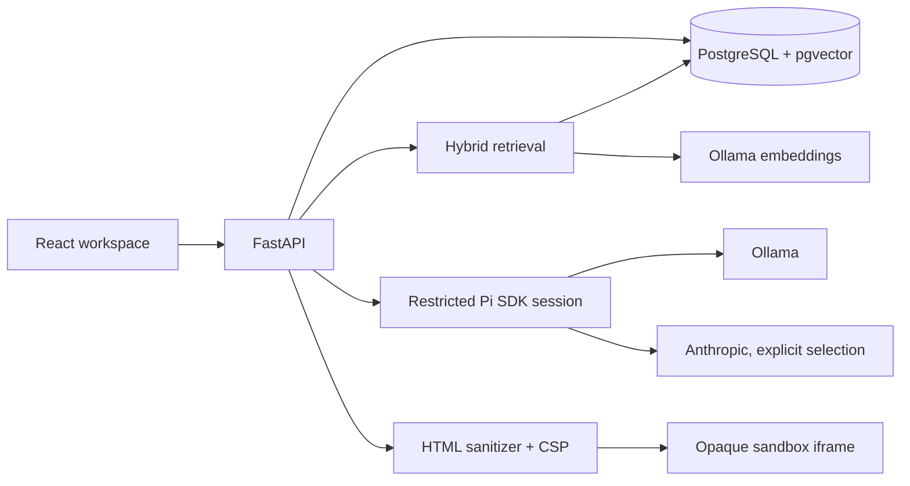

# Architecture

React/Vite/TypeScript provides the conversation and evidence/artifact workspace.
FastAPI owns session persistence, retrieval, validation and error handling.
A real Pi Coding Agent SDK session generates responses through Ollama or an explicitly
selected Anthropic model. There is no automatic cloud fallback.

## Request lifecycle

1. Validate the typed request and acquire a PostgreSQL advisory transaction lock for
   its session. Simultaneous writes to the same chat return a structured conflict.
2. Load history only for that session. Expand short follow-up retrieval with the last
   user question. Embed the query using nomic-embed-text (768 dimensions).
3. Retrieve nearest passages from eligible episodes. Apply the cosine-distance cutoff
   (default 0.35), then reciprocal rank fusion with PostgreSQL full-text ranks (k=60).
   Supply three complete passages, with at most two from one episode URL and no exact text duplicates.
4. Without evidence, return an explicit refusal. Embedding outages return a service error.
5. Choose Q&A, Ship 30, HTML or Markdown instructions. Supply bounded history and source
   excerpts as untrusted data to Pi. Pi runs without tools, discovered instructions,
   plugins, disk sessions or persisted credentials. A subprocess timeout kills generation.
6. Reject responses without valid citation IDs, or with invented IDs. This is a structural
   citation check, not proof that every claim is entailed. Semantic review remains necessary.
7. Persist user and assistant messages and any artifact in one transaction. A failure rolls
   back the turn. Return the completed response atomically; SSE is not implemented.

## Storage and ingestion

Five tables: sessions (title, timestamps, user metadata), messages (role, content, citations,
provider/model/status), artifacts, episodes (source metadata, content hash, eligibility), and
chunks (exact normalized-text offsets, timestamp, vector). Alembic manages schema changes;
HNSW and full-text indexes support retrieval. Session history remains intact during reindexing.

Ingestion reads official corpus YAML frontmatter and transcript bodies, creates overlapping
2,400-character passages, embeds batches and replaces each episode transactionally.
Unchanged content and index versions are skipped. Embedding truncation is enabled to handle
unusually token-dense text. The source audit quarantines missing/changed sources, duplicate
path aliases, identical bodies with different URLs and detectable guest/title conflicts; it preserves raw files and existing rows.
This conservative check does not independently verify every upstream URL.

## Configuration and deployment

The default local model is `lenny-local`, a llama3.2:3b copy with 12,288 context tokens,
a documented CPU-friendly alternative to llama3.1:8b. Pi reserves 4,096 safety tokens;
the configured context must leave room for prompts and 3,000 essay output tokens. Model performance depends on hardware. Anthropic requires both key and model ID;
OpenAI settings are reserved, not an implemented provider. API configuration exposes no keys.

The production Dockerfile builds the React bundle and bundles Python + Node + locked Pi
packages. FastAPI serves the bundle. Compose runs PostgreSQL and API; Ollama runs on the host.
A separate ingestion profile mounts raw/processed data. The standard Docker build succeeded
on 11 October 2026 with fresh npm installation stages; the prebuilt alternative remains
documented for restricted networks. Windows host development is also supported.

Local ports bind to loopback. This demo has no authentication and does not support shared
hosting. See security.md for artifact isolation, provider disclosure and remaining risks.
Structured application logs contain request/session/model/latency/error fields without
conversation text or API keys. Uvicorn access logs may additionally use its standard format.
